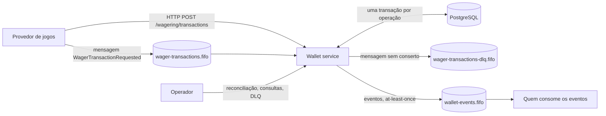
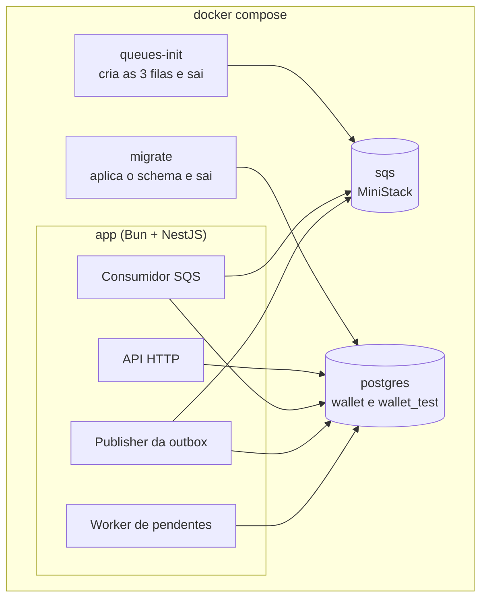
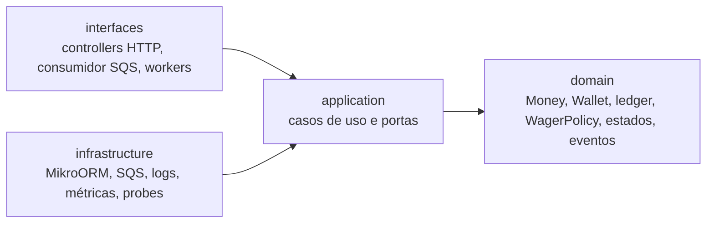
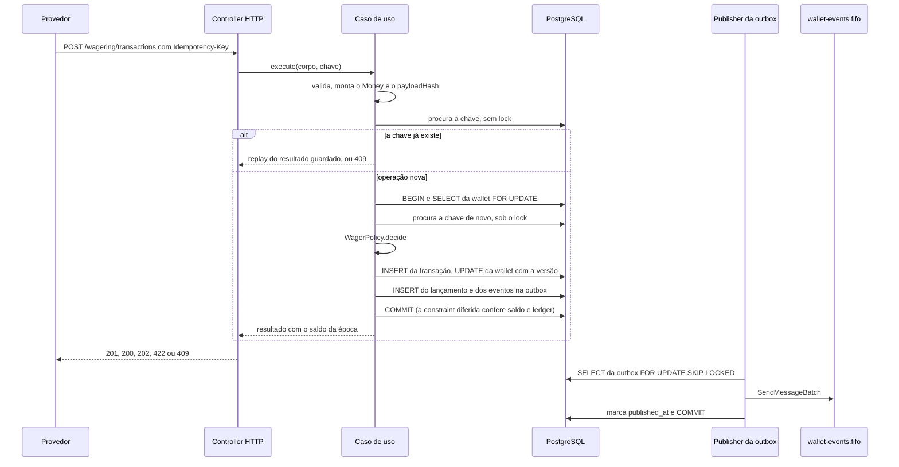
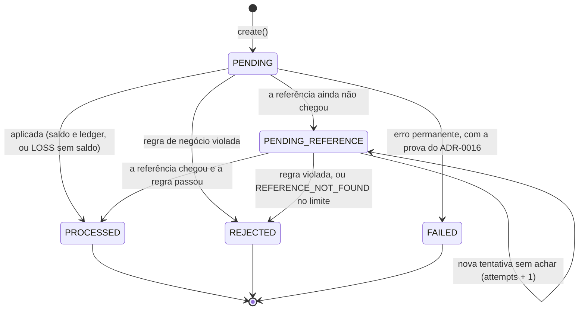

# Arquitetura, decisões, trade-offs e limitações

Este documento explica **como** o serviço de wallet garante o que o enunciado exige e **por quê**.
Para subir e conferir cada requisito em 5 minutos, veja o [README](README.md); para uma decisão a
fundo, com as alternativas recusadas, o ADR dela em [docs/adr](docs/adr/README.md).

**A regra deste documento:** só entra o que foi **medido** ou **testado**. Onde algo é desenho e não
está implementado (a autenticação, a fila por wallet), a seção diz isso. Todo número diz como
refazê-lo: com um comando do repositório (`bun run test:concurrency` imprime uma linha
`[concurrency]` por cenário, com requisições, 503, tempo e invariantes), ou, quando não há comando
(as sabotagens, feitas editando o código à mão), com a marca "medido durante o desenvolvimento
(26/11/2026, Windows 11 com Docker Desktop, Bun 1.4.5)". Os números marcados assim variam de máquina
para máquina.

**Sumário**

1. [Objetivos: as invariantes e quem as garante](#1-objetivos-as-invariantes-e-quem-as-garante)
2. [Contexto e containers](#2-contexto-e-containers)
3. [Camadas e fronteiras](#3-camadas-e-fronteiras)
4. [Em execução: uma aposta, os estados, a fila](#4-em-execução-uma-aposta-os-estados-a-fila)
5. [Decisões](#5-decisões)
6. [Como os testes provam](#6-como-os-testes-provam)
7. [Riscos, limitações e trabalho futuro](#7-riscos-limitações-e-trabalho-futuro)
8. [Glossário](#8-glossário)
9. [Índice dos ADRs](#9-índice-dos-adrs)

---

## 1. Objetivos: as invariantes e quem as garante

O enunciado (seção 3) fixa as invariantes globais. Cada uma tem uma defesa no código e outra no
banco, porque "As garantias de unicidade, imutabilidade e não-negatividade descritas na seção 6
devem ser aplicadas no schema do banco, não apenas em código de aplicação" (enunciado, seção 5).

| Invariante | No código | No banco | Detalhe |
| --- | --- | --- | --- |
| Saldo nunca negativo | `WagerPolicy` recusa (`INSUFFICIENT_FUNDS`) sob o lock da wallet | `CHECK (balance >= 0)` | [5.2](#52-concorrência-lock-pessimista-por-wallet) |
| Sem débito nem crédito duplicado | chave de idempotência e inbox, conferidas antes e depois do lock | `UNIQUE (idempotency_key)`, `UNIQUE (provider_id, external_transaction_id)`, PK da inbox | [5.3](#53-idempotência-em-duas-camadas-e-o-payloadhash) |
| Sem *lost update* | `SELECT … FOR UPDATE` + `UPDATE … WHERE version = $esperada` | `UNIQUE (wallet_id, wallet_version)` no ledger | [5.2](#52-concorrência-lock-pessimista-por-wallet) |
| Toda mudança de saldo tem lançamento | `Wallet.debit/credit` devolvem o lançamento | `trg_wallet_balance_has_ledger` (constraint diferida, no COMMIT) e `CHECK` aritmético do lançamento | [5.4](#54-regras-de-negócio-e-as-interpretações-adotadas) |
| Ledger auditável e imutável | `WalletLedgerEntry` sem métodos de mudança | triggers recusam `UPDATE`, `DELETE` e `TRUNCATE` | [5.4](#54-regras-de-negócio-e-as-interpretações-adotadas) |
| Estado final não muda | `WagerTransaction` lança ao sair de um estado final | trigger recusa `UPDATE` de `PROCESSED`, `REJECTED`, `FAILED` | [4.2](#42-a-máquina-de-estados-da-transação) |
| Nenhum evento confirmado se perde; nada publicado antes do commit | eventos só vão para a outbox, na transação do negócio | a outbox é uma tabela, na mesma transação | [5.7](#57-mensageria-consumidor-outbox-pendentes-e-failed) |
| Correto com várias instâncias | nenhum estado de negócio em memória | todas as decisões sob lock de linha | [5.2](#52-concorrência-lock-pessimista-por-wallet) |

---

## 2. Contexto e containers

**Contexto** (nível 1 do C4): quem fala com o serviço e por onde.



**Containers** (nível 2 do C4): o que o `docker compose up` sobe. O mesmo processo da aplicação roda
quatro papéis, cada um ligável por variável (`SQS_CONSUMER_ENABLED`, `OUTBOX_PUBLISHER_ENABLED`,
`PENDING_WORKER_ENABLED`); com várias instâncias, cada papel roda em todas, e o banco decide.



---

## 3. Camadas e fronteiras

(ADR-0001, ADR-0003)



- **`src/domain`**: regras puras, sem relógio, banco nem framework. A decisão de negócio de uma
  transação é uma função (`WagerPolicy.decide`) que recebe a wallet, a transação e a referência e
  devolve *aplicar*, *rejeitar com um código* ou *esperar a referência*.
- **`src/application`**: os casos de uso e as **portas** (classes abstratas que a infraestrutura
  implementa): `UnitOfWork`, repositórios, leitores, `MetricsPort`, `ProviderIdentityPort`. Os
  casos de uso entram no Nest por `useFactory`, sem decorador de framework.
- **`src/infrastructure`**: MikroORM v7 com `defineEntity`, **fora** do domínio. As classes do
  domínio **não** são as entidades do ORM; o mapeamento é explícito nos dois sentidos
  (`rehydrate`). Os construtores do domínio são privados (`create`/`open`/`rehydrate`).
- **`src/interfaces`**: só convertem entrada em comando e resultado em status.

**A fronteira é verificada, não combinada.** `bun run check:money` (também no CI) falha se
`src/domain` ou `src/application` importar Nest, MikroORM ou o AWS SDK; se `decimal.js` for
importado fora de `src/domain/money`; ou se uma linha que fala de `amount`, `balance` ou `money`
converter para `number`. É uma heurística de linha, e o ADR-0006 diz o que ela não prova.

---

## 4. Em execução: uma aposta, os estados, a fila

### 4.1 Uma aposta por HTTP

A mesma operação por HTTP ou por SQS passa pelo **mesmo caso de uso**
(`ProcessWagerTransactionUseCase`) e dá o mesmo `payloadHash`. Tudo o que a operação grava vai numa
**única transação SQL**: ou tudo é confirmado, ou nada.



### 4.2 A máquina de estados da transação

(enunciado, seção 6.3; ADR-0004, ADR-0016)



| Estado | Significado | Quem garante |
| --- | --- | --- |
| `PENDING` | aceita, ainda não aplicada. Só existe **em memória e num INSERT**: a transação é decidida antes de ser gravada | o trigger recusa qualquer `UPDATE` que leve a `PENDING` |
| `PENDING_REFERENCE` | espera a transação referenciada; o worker a resolve (seção 4.4) | o único estado não final que vai para o banco |
| `PROCESSED` | aplicada. Final | trigger: nenhum `UPDATE` sai de um estado final; o domínio lança `InvalidTransactionStateError` |
| `REJECTED` | regra de negócio violada, com `failureCode` e o saldo da época. Final e auditável | idem |
| `FAILED` | erro permanente de infraestrutura, com `PROCESSING_FAILED`, sem saldo nem ledger. Final e auditável | idem; só nasce com a prova de que nenhuma tentativa foi transitória (seção 5.7) |

O domínio e o trigger também aceitam `PENDING_REFERENCE → FAILED`, mas nenhum caminho do código o usa
hoje: o worker de pendentes só resolve para `PROCESSED`, `REJECTED` ou mais uma espera. A
`rehydrate` não revalida transições; só reconstrói o que o banco guardou (seção 6.0 do enunciado).
Teste: `test/unit/domain/wager-transaction.test.ts` (cada transição, a partir de cada estado) e
`test/integration/schema-wager-transactions.test.ts` (o trigger).

### 4.3 Uma aposta pela fila

O consumidor faz *long polling* (lotes de até 10), agrupa por `MessageGroupId` (grupos em paralelo,
dentro do grupo em sequência) e chama o mesmo caso de uso, com a identidade da inbox
`(consumerName, messageId)`. O `DeleteMessage` (o ack) só acontece **depois** do commit; se o
processo morrer entre os dois, a mensagem volta e vira replay. O que cada desfecho faz com a
mensagem está na seção 5.7.

### 4.4 Uma referência que chega antes

Um REFUND, ROLLBACK, WIN ou LOSS que aponta para uma BET que ainda não chegou é aceito como
`PENDING_REFERENCE` (202) e gera o evento `WagerTransactionPendingReference` (ADR-0013):

- **Política:** 10 tentativas no total (a primeira gravação conta), espera `min(2^n × 1 s, 5 min)`:
  9 esperas = 1+2+4+8+16+32+64+128+256 = **511 s, cerca de 8,5 minutos**. Esgotadas, vira `REJECTED`
  com `REFERENCE_NOT_FOUND` e o evento `WagerTransactionRejected`: nada fica pendente para sempre.
- **O campo `attempts`** conta as tentativas que **não** acharam a referência (cada uma deixou a
  transação em `PENDING_REFERENCE` e agendou a próxima). A tentativa que **decide** (resolve ou
  rejeita) não incrementa. Com o limite de 10: uma referência que nunca chega dá 9 tentativas sem
  achar e a 10ª rejeita, então a transação fica `REJECTED` com `attempts: 9`; uma que chega na 2ª
  tentativa fica `PROCESSED` com `attempts: 1`. Tentativas feitas = `attempts` + 1.
- **Acordar:** quando a BET é processada, as pendentes **da mesma wallet** que a esperam são
  agendadas para agora, sob o lock; o worker as resolve no ciclo seguinte. Se o atalho se perder,
  o `next_attempt_at` vence sozinho.
- **Dois workers não pegam o mesmo item:** a reserva é um `UPDATE … FOR UPDATE SKIP LOCKED` que
  escreve **só** `next_attempt_at` (um *lease* de 30 s), sem o lock da wallet. Quem decide
  (`ResolvePendingReferenceUseCase`) **trava a wallet e relê tudo**: o pior que a reserva causa é
  trabalho repetido, nunca um estado errado.

---

## 5. Decisões

Cada decisão em poucas linhas: o problema, a escolha e o porquê. As alternativas recusadas estão no
ADR citado.

### 5.1 Stack: MikroORM, o mapeamento do Money e a estratégia transacional

(ADR-0003, ADR-0006, ADR-0007; enunciado, seção 4)

- **MikroORM v7, e não TypeORM.** O enunciado o prefere pelo *Unit of Work*, pelo *Identity Map*
  explícito, pelo `EntityManager.transactional()` e pelo `LockMode`, que é exatamente o que a
  concorrência usa (`LockMode.PESSIMISTIC_WRITE`, `PESSIMISTIC_PARTIAL_WRITE` para o `SKIP LOCKED`).
  Com `defineEntity`, sem decorators: o domínio não conhece o ORM.
- **O Money no banco.** Um `Money` imutável sobre `decimal.js`, com string de 2 casas exatas
  (`"25.00"`), sem arredondar nem completar (`"10.5"` e `"10.005"` são recusados) e com teto de 16
  dígitos inteiros. No banco é `NUMERIC(20,2)` lido **como string** (`p.decimal('string')`), e a
  moeda fica numa coluna própria (`CHAR(3)`); o mapper reidrata com `Money.from`. A aritmética de
  dinheiro do banco (reconciliação) é feita em `NUMERIC`, nunca em ponto flutuante.
- **A estratégia transacional.** Uma operação financeira é **uma** transação `READ COMMITTED`
  aberta pelo `UnitOfWork` (`em.fork().transactional()`, um `EntityManager` novo por operação, sem
  cache entre operações), com `SET LOCAL lock_timeout` só para ela. Transação, saldo, lançamento,
  eventos da outbox e inbox entram nessa transação (ADR-0007, ADR-0008).

### 5.2 Concorrência: lock pessimista por wallet

(ADR-0007; enunciado, seção 8)

Duas BETs de 60,00 numa wallet de 100,00 leem o mesmo saldo, as duas passam na regra, e o saldo
iria a −20,00. A unidade de concorrência é a wallet, e a defesa tem **quatro barreiras**:

| # | Barreira | Onde | O que pega |
| --- | --- | --- | --- |
| 1 | `SELECT … FOR UPDATE` na wallet, dentro de **uma** transação `READ COMMITTED` | caso de uso + `UnitOfWork` | serializa as operações da mesma wallet; quem entra vê o saldo final |
| 2 | `UPDATE wallets … WHERE id = $1 AND version = $esperada` precisa afetar 1 linha | repositório | um bug que escreva sem o lock |
| 3 | `UNIQUE (wallet_id, wallet_version)` no ledger | schema | dois lançamentos para a mesma versão |
| 4 | `CHECK (balance >= 0)` | schema | o saldo negativo, mesmo se tudo acima falhar |

- **Por que pessimista, e não otimista nem `SERIALIZABLE`.** Numa wallet muito usada quase toda
  tentativa otimista conflitaria e refaria o trabalho; `SERIALIZABLE` devolve erros de serialização
  que o código teria de repetir e cobra de toda operação, não só das concorrentes. O lock é da
  própria linha da wallet: **não existe lock global** (um advisory lock trava por um número que o
  banco não relaciona às linhas).
- **Sem deadlock por desenho.** Cada operação trava **uma** wallet. A referência de uma reversão é
  lida sem lock, e isso é seguro pela regra que vale para o sistema todo: *toda decisão de estado
  ou de dinheiro acontece sob o lock da wallet; colunas só de agendamento (`next_attempt_at`) podem
  ser escritas sem ele, porque toda decisão relê sob o lock.*
- **Prazo.** O `lock_timeout` é de 5 s (`DB_LOCK_TIMEOUT_MS`): estourou, é falha **transitória**
  (503 com `Retry-After`), sem gravar nada, e reenviar a mesma chave é seguro. A espera pelo lock é
  medida em `wallet_lock_wait_seconds`.

**O que acontece quando se remove cada barreira.** Cada linha é uma **sabotagem**: tirei a proteção
do código, rodei a suíte de concorrência e registrei o que quebrou, para provar que os testes
enxergam cada defesa. Os números: medido durante o desenvolvimento (26/11/2026, Windows 11 com
Docker Desktop, Bun 1.4.5), editando o código à mão. Não há script que refaça as sabotagens; o que
dá para refazer é a suíte com o código certo (`bun run test:concurrency`).

| Sabotagem | Testes que falham | Sintoma |
| --- | --- | --- |
| (a) sem `FOR UPDATE` | 8 | `500 ConcurrentWalletUpdateError`: a **versão** segura; saldo e ledger continuam corretos |
| (b) sem `FOR UPDATE` e sem versão | 8 | `500 DuplicateKeyError uq_ledger_wallet_version`: o **ledger** segura |
| (c) sem `CHECK (balance >= 0)`, mantendo o lock | 1 | saldo final −60,00 no teste que tira o lock do caminho; os outros seguem verdes **por desenho** (com o lock o código nunca chega ao `CHECK`) |
| (d) sem lock, sem versão e sem `uq_ledger_wallet_version` | 8 | **lost update de verdade**: as duas BETs de 80,00 ficam `PROCESSED`; o check global achou 434 violações em 775 wallets |
| (e) lock **global** (advisory) no lugar do lock por wallet | 1 | só o teste "com a wallet A travada, a BET na B termina" falha; serializar tudo continua correto, só mais lento |

As barreiras 2, 3 e 4 são **redes de segurança** que nunca disparam com o código certo; só
removendo as três (d) aparece corrupção.

**O limite conhecido: 503 em rajadas maiores que o pool (não é defeito).** O 503 aparece em
**qualquer rajada maior que o pool**, não só na wallet quente. Cada requisição ocupa uma conexão do
pool (20 por processo, `DB_POOL_MAX`) durante a transação inteira; quando chegam mais requisições
ao mesmo tempo do que há conexões, as que sobram esperam `DB_ACQUIRE_TIMEOUT_MS` por uma conexão
livre e levam **503 com `Retry-After`**, mesmo em wallets distintas. Rajada de 150 requisições em
30 wallets distintas (5 BETs de 30,00 em cada wallet de 100,00), 3 execuções por valor, um processo
(medido durante o desenvolvimento (27/11/2026, Windows 11 com Docker Desktop, Bun 1.4.5)):

| Acquire timeout | 503 na 1ª tentativa (de 150) | Tempo total | p95 | Rodadas de reenvio |
| --- | --- | --- | --- | --- |
| 1 s | 87–105 | 2,5–3,0 s | 1,9–2,6 s | 2–3 |
| 3 s (padrão) | 19–52 | 4,5–5,2 s | 4,0–4,8 s | 1 |
| 5 s | 0 | 5,5–6,1 s | 5,0–5,6 s | 0 |
| 3 s (padrão), **outra máquina** ¹ | 0–85 | 5,1–6,2 s | 4,1–5,7 s | 0–2 |

¹ Medido na segunda avaliação independente (27/11/2026, Windows 11 com Docker Desktop, outra
máquina), com o mesmo `bun scripts/burst.ts`, 3 execuções: 0, 69 e 85 respostas 503; as 30 wallets
terminaram certas em todas.

**Estes números são medidas destas máquinas; não são uma propriedade do sistema.** Dependem do host, da
carga do Docker e do que mais estiver rodando: na segunda avaliação a mesma configuração deu de 0 a 85
respostas 503 e um p95 de até 5,7 s. O que o sistema garante é outra coisa: nenhum reenvio de um 503
duplica um lançamento, e o 503 vem com `Retry-After`.

Em todas as execuções as 30 wallets terminaram certas depois do reenvio dos 503. A vazão é a mesma
nos três valores: um timeout maior troca 503 por espera. O padrão é **3 s**: nas medições da tabela cortou de
50% a 80% dos 503 de 1 s, com o p95 perto de 5 s. 5 s não foi escolhido porque somaria com o `lock_timeout` (5 s) e
dobraria o pior caso de uma requisição, o que tende a estourar o timeout do provedor. Refaça com:

```bash
DB_ACQUIRE_TIMEOUT_MS=1000 docker compose up -d --wait app   # ou 3000, 5000
bun scripts/burst.ts                                          # 150 requisições, 30 wallets
```

Na **wallet quente** o efeito é mais forte: quem espera o lock **segura uma conexão sem fazer
nada**. Com 290 requisições simultâneas na mesma wallet (e o acquire timeout antigo, de 1 s), de
154 a 343 respostas 503 com 1 processo e de 228 a 535 com 3, **100% por pool sem conexão e 0 por
`lock_timeout`**, nenhum reenvio duplicando (medido durante o desenvolvimento (26/11/2026,
Windows 11 com Docker Desktop, Bun 1.4.5), várias execuções). Uma execução se refaz com
`bun test test/concurrency/hot-wallet.test.ts` e `bun test test/concurrency/multi-instance.test.ts`,
e o jitter do reenvio do cliente com
`CLIENT_RETRY_JITTER=wide bun test test/concurrency/multi-instance.test.ts`: com 3 processos ele
corta os 503 em cerca de 25–30%, sem melhorar o tempo total. É o **controle de admissão**
funcionando: recusar com segurança em vez de enfileirar sem limite. O custo é tempo e tráfego de
reenvio, nunca correção.

### 5.3 Idempotência em duas camadas e o `payloadHash`

(ADR-0008; enunciado, seção 9)

O provedor reenvia (timeout no HTTP, entrega *at-least-once* no SQS, queda depois do commit e antes
do ack). São duas perguntas diferentes:

- *Esta **entrega** da fila já foi processada?* → **inbox** (`inbox_messages`, chave primária
  `(consumer_name, message_id)`), gravada na **mesma transação** do negócio. Toda entrega deixa a
  sua linha, inclusive a resolvida como replay (com `ON CONFLICT DO NOTHING` e a comparação do
  hash): o mesmo `messageId` com outro payload é sempre `INBOX_MESSAGE_REUSED` (DLQ).
- *Esta **operação de negócio** já foi processada?* → **chave de idempotência**
  (`wager_transactions.idempotency_key` é `UNIQUE`). Vale entre instâncias **e entre canais**: a
  mesma BET por HTTP e por SQS é uma operação só.

| Situação | Resultado |
| --- | --- |
| Chave nova | processa |
| Mesma chave, mesmo hash | replay do resultado guardado (`idempotentReplay: true`, com o saldo **da época**, não o de hoje) |
| Mesma chave, hash diferente | `409 IDEMPOTENCY_KEY_REUSED` |
| Chave nova, mas `(provider_id, external_transaction_id)` já existe | `409 EXTERNAL_ID_CONFLICT` |
| Wallet inexistente | `404 WALLET_NOT_FOUND`, **nada gravado** |

**Duas checagens por chave.** O caminho rápido (antes da transação, sem lock) resolve quase todos
os replays sem travar nada; a mesma checagem se repete **depois** do lock, porque outra requisição
igual pode ter commitado entre as duas. Os `UNIQUE` são a última barreira. Dois casos achados pelos
testes: (1) a mesma operação pode commitar **entre** as duas leituras do caminho rápido (chave e id
externo), então, antes de responder `EXTERNAL_ID_CONFLICT`, o caso de uso relê a chave; (2) a mesma
chave com `walletId` diferente trava wallets diferentes e passa junta pelas checagens: a segunda
esbarra no índice único (`23505`), o caso de uso captura **só** esse `23505`, deixa o rollback
acontecer e roda **mais uma vez, no máximo uma**.

**O algoritmo do `payloadHash`** (`computePayloadHash`, no domínio):

1. Só campos de **negócio**: `providerId`, `externalTransactionId`, `playerId`, `walletId`,
   `roundId`, `gameId`, `kind`, `money.amount`, `money.currency` e
   `referenceExternalTransactionId` (só quando existe). O header, o `idempotencyKey`, o
   `messageId`, o `correlationId` e qualquer metadado de transporte ficam **de fora**.
2. Um JSON com as chaves em ordem alfabética, sem espaços, com `money` aninhado como
   `{ "amount", "currency" }`, e o valor já normalizado em 2 casas.
3. SHA-256 desse texto em UTF-8, em hexadecimal minúsculo (64 caracteres).

Vetores fixos nos testes impedem mudar o algoritmo sem perceber (isso invalidaria os hashes
gravados), e a mesma operação por HTTP e por SQS dá o mesmo hash. O hash é parte do contrato.

### 5.4 Regras de negócio e as interpretações adotadas

(ADR-0004, ADR-0005, ADR-0006; enunciado, seção 7, que pede "qualquer interpretação adicional
adotada deve ser documentada")

| Operação | Efeito | Lançamento | Regra |
| --- | --- | --- | --- |
| BET | débito | 1 DEBIT | recusada sem saldo (`INSUFFICIENT_FUNDS`) |
| WIN | crédito | 1 CREDIT | pode referenciar a BET da mesma rodada |
| LOSS | nenhum | nenhum | registra o resultado |
| REFUND | crédito | 1 CREDIT | só de uma BET `PROCESSED`, uma vez |
| ROLLBACK | o inverso da referência | 1 invertido | de uma BET, WIN ou REFUND `PROCESSED`, uma vez; sem saldo para desfazer, `REVERSAL_INSUFFICIENT_FUNDS` (distinto de `INSUFFICIENT_FUNDS`) |

Interpretações próprias, todas testadas:

- **Uma reversão por transação, de qualquer tipo** (ADR-0005). O enunciado proíbe reverter duas
  vezes "pelo mesmo tipo"; levado ao pé da letra, BET 25,00 → REFUND → ROLLBACK da BET devolveria
  o dinheiro duas vezes. Índice único parcial `uq_wtx_reversed_once`.
- **Prêmio pago impede devolver a aposta** (`REFERENCE_SETTLED`). Um WIN `PROCESSED` de valor maior
  que zero, não revertido, que aponta para a BET **ou** que não aponta para nada e é da mesma
  wallet, provedor e rodada, liquida a BET: devolvê-la deixaria o jogador com os dois. **A ordem
  inversa também:** se a BET da rodada já foi devolvida (REFUND ou ROLLBACK), um WIN da mesma rodada,
  com ou sem referência e de valor maior que zero, é `REFERENCE_ALREADY_REVERSED`. Nas duas ordens, e
  numa corrida das duas, o jogador nunca fica com a aposta de volta e com o prêmio.
- **WIN e LOSS de 0,00 são aceitos** (o resultado é registrado, sem lançamento); BET, REFUND e
  ROLLBACK precisam de valor maior que zero.
- **A BET não leva referência**: `referenceExternalTransactionId` numa BET é 400.
- **Moeda**: só códigos ISO-4217 vigentes (`src/domain/money/iso-4217.ts`); fora da lista é 400; uma
  moeda válida que não é a da wallet é `422 CURRENCY_MISMATCH`.
- **Teto do saldo**: 16 dígitos inteiros, também no `initialBalance`; um crédito que passaria dele
  é `422 BALANCE_LIMIT_EXCEEDED`, gravado e auditável.
- **O provedor `internal` é do sistema** (o da transação de abertura): `providerId` `internal` ou
  uma `Idempotency-Key` `internal:…` é 400, e a consulta por provedor responde 404 para ele.
- **Saldo ↔ ledger no schema**: a constraint diferida `trg_wallet_balance_has_ledger` recusa, no
  COMMIT, uma wallet cujo saldo não tem o lançamento da versão atual (um UPDATE cru do saldo, uma
  versão pulada, uma wallet que nasce com saldo sem a abertura).

### 5.5 Taxonomia de `failureCode`

(ADR-0009; enunciado, seção 7.2; `src/domain/errors/failure-code.ts`)

São **20 códigos** de domínio, em 5 categorias. **Só `DEPENDENCY_UNAVAILABLE` é reenviável**; nos
outros, reenviar a mesma chave sem mudar nada dá exatamente o mesmo resultado.

| Categoria | Código | HTTP | O que significa | O que o provedor faz |
| --- | --- | --- | --- | --- |
| validação | `INVALID_PAYLOAD` | 400 | corpo fora do contrato (campo ausente, tipo errado, JSON ruim, texto com caractere de controle, moeda fora da ISO-4217, BET com `referenceExternalTransactionId`) | **corrigir** e reenviar com a **mesma** chave: um 400 não grava nada |
| validação | `INVALID_AMOUNT` | 400 | valor fora do formato (`"10.5"`, `"1e3"`, negativo, 3 casas) | **corrigir** e reenviar com a **mesma** chave |
| validação | `UNSUPPORTED_KIND` | 400 | `kind` fora de BET, WIN, LOSS, REFUND, ROLLBACK (OPENING é interno) | **corrigir** e reenviar com a **mesma** chave |
| idempotência | `IDEMPOTENCY_KEY_REUSED` | 409 | mesma chave com conteúdo diferente | **não reenviar**: é bug do provedor |
| idempotência | `EXTERNAL_ID_CONFLICT` | 409 | o id externo já existe sob outra chave | **não reenviar**; reconciliar as chaves |
| negócio | `WALLET_NOT_FOUND` | 404 | a wallet não existe (nada foi gravado) | criar a wallet e reenviar a **mesma** chave; na fila, a mensagem vai para a DLQ |
| negócio | `WALLET_PLAYER_MISMATCH` | 422 | a wallet é de outro jogador | **desistir** |
| negócio | `CURRENCY_MISMATCH` | 422 | moeda da transação ≠ moeda da wallet | **desistir** |
| negócio | `INSUFFICIENT_FUNDS` | 422 | a BET passa do saldo | **desistir** desta chave |
| negócio | `REVERSAL_INSUFFICIENT_FUNDS` | 422 | o ROLLBACK deixaria o saldo negativo | **desistir** |
| negócio | `REFERENCE_NOT_FOUND` | 422 | a referência não chegou em 10 tentativas (≈ 8,5 min) | **desistir**, ou reenviar a referência e a operação com chaves novas |
| negócio | `REFERENCE_MISMATCH` | 422 | a referência é de outro jogador, wallet, moeda ou rodada | **desistir** |
| negócio | `REFERENCE_NOT_PROCESSED` | 422 | a referência existe mas não está `PROCESSED` | **desistir** |
| negócio | `REFERENCE_KIND_NOT_ALLOWED` | 422 | tipo de referência que a operação não aceita | **desistir** |
| negócio | `AMOUNT_MISMATCH` | 422 | o valor da reversão difere do da referência | **desistir** |
| negócio | `REFERENCE_ALREADY_REVERSED` | 422 | a referência já foi revertida | **desistir** |
| negócio | `REFERENCE_SETTLED` | 422 | reverter uma BET que já pagou prêmio | **desistir** (reverta o WIN antes) |
| negócio | `BALANCE_LIMIT_EXCEEDED` | 422 | o crédito passaria do teto de 16 dígitos inteiros do saldo | **desistir** até o saldo baixar |
| transitório | `DEPENDENCY_UNAVAILABLE` | **503** + `Retry-After` | banco fora, pool cheio, `lock_timeout`, deadlock | **reenviar a mesma chave** depois do `Retry-After`; nada foi gravado |
| permanente | `PROCESSING_FAILED` | **500** | erro permanente de infraestrutura: a transação ficou `FAILED` (ADR-0016) | **não reenviar a mesma chave**; corrigir a causa e mandar com chave nova |

Além dos 20, a API tem códigos que **não** são de transação: `WALLET_ALREADY_EXISTS` (409),
`TRANSACTION_NOT_FOUND` (404), `INTERNAL_ERROR` (500), `UNAUTHENTICATED` (401) e
`PROVIDER_FORBIDDEN` (403). **`REJECTED` não é erro de infraestrutura**: a transação rejeitada é
gravada (id, saldo da época e `failureCode`) e o replay devolve a mesma resposta.

### 5.6 Mapa de status HTTP

(ADR-0009; enunciado, seção 9: distinguir payload inválido, conflito, rejeição, pendência e falha
transitória, de forma consistente entre as rotas)

| Situação | Status | Corpo |
| --- | --- | --- |
| Transação processada (1ª vez) | **201** | `{ transactionId, status, balance, idempotentReplay: false }` |
| Replay de transação processada | **200** | o mesmo corpo, `idempotentReplay: true`, saldo da época |
| Aceita, aguardando a referência | **202** | `status: PENDING_REFERENCE`, sem `balance` |
| Rejeitada por regra de negócio | **422** | `status: REJECTED`, `failureCode`, `balance` |
| Payload inválido, JSON ruim, `Idempotency-Key` ausente, inválida ou repetida | **400** | erro, com `details` |
| Wallet, transação ou rota inexistente | **404** | erro |
| Conflito de idempotência, ou wallet já existente | **409** | erro |
| Corpo acima do limite | **413** | erro |
| Falha transitória de infraestrutura | **503** + `Retry-After` | erro, `retryable: true` |
| Erro inesperado (bug), e o replay de uma transação `FAILED` (ADR-0016) | **500** | erro |
| Sem credencial, ou provedor sem direito sobre o `providerId` | 401 / 403 | erro (seção 5.10) |

O formato de erro é um só em todas as rotas: `{ "error": { "code", "message", "retryable",
"correlationId" } }`, com `details: [{ path, message }]` nos 400; SQL, constraint e stack vão para o
**log**, com o mesmo `correlationId`, nunca para a resposta. O mapa é uma tabela **total**
(`Record<ApiErrorCode, number>`): um código novo não compila sem um status. As consultas (`GET`)
respondem 200 para qualquer status guardado, e a reconciliação responde 200 mesmo divergente (a
resposta é o relatório).

### 5.7 Mensageria: consumidor, outbox, pendentes e `FAILED`

(ADR-0011, ADR-0012, ADR-0013, ADR-0016; enunciado, seções 10 e 11)

**O consumidor** decide o destino de cada mensagem pelo tipo do resultado:

| O que aconteceu | Ação |
| --- | --- |
| `PROCESSED`, `REJECTED`, `PENDING_REFERENCE`, replay | **ack** |
| `IDEMPOTENCY_KEY_REUSED`, `EXTERNAL_ID_CONFLICT` (terminais e determinísticos) | **ack** + log `warn` com `messageId` e `idempotencyKey` |
| `DEPENDENCY_UNAVAILABLE` (banco, `lock_timeout`, pool) | **não apaga**; devolve a visibilidade com backoff `min(2^n × 2 s, 60 s)` |
| JSON, envelope ou payload inválido; `WALLET_NOT_FOUND`; mesmo `messageId` com outro conteúdo; erro `critical` | **DLQ** (o `critical` também loga `fatal`) |
| o banco recusou o **dado** (SQLSTATE classe `22`, ou `08P01`) | **DLQ** já, sem retry: reenviar daria o mesmo erro e seguraria a wallet |
| erro permanente em **todas** as entregas, com a prova | grava `FAILED` com `PROCESSING_FAILED` e ack (abaixo) |
| transitório até a última das 10 entregas | **DLQ** (`RETRIES_EXHAUSTED`) |

- **Ack só depois do commit.** O `DeleteMessage` vem depois do handler, que inclui o commit. Um
  conflito de idempotência é ack porque é terminal; `WALLET_NOT_FOUND` vai para a DLQ porque não
  gravou nada e um operador pode reinjetar a mensagem depois de criar a wallet.
- **DLQ por envio explícito**, com `reason`, `failureCode`, `originalMessageId` e `receiveCount`; o
  *redrive* da fila (10 entregas) é a rede de segurança. Se o envio à DLQ falha, a original não é
  apagada.
- **FIFO por wallet é otimização.** Com `MessageGroupId = walletId`, a mensagem em backoff segura as
  seguintes da mesma wallet (preserva a ordem); a garantia de correção continua sendo do banco.

**`FAILED` só com prova** (ADR-0016). O risco de gravar `FAILED` é transformar uma falha passageira
em resultado permanente: uma queda longa do banco esgota as 10 entregas. Por isso cada entrega que
falha com erro **permanente** soma 1 em `consumer_delivery_failures`, numa instrução própria, e o
`FAILED` só é gravado quando a soma é **igual** ao número de entregas. Uma entrega sem registro (o
banco estava fora, ou a mensagem voltou por crash) é falta de prova, e falta de prova vai para a
DLQ, de onde um redrive a processa normalmente. No HTTP, só um `PermanentDataError` vira `FAILED`. O
`FAILED` é gravado numa transação separada, sob o lock da wallet, sem saldo, ledger nem evento (a
linha é a auditoria); o reenvio da mesma chave recebe sempre o mesmo `FAILED`.

**A outbox.** Eventos **só vão para a outbox**, na mesma transação do saldo e do ledger; nunca direto
no SQS. O publisher lê com `FOR UPDATE SKIP LOCKED`, **segurando a transação** durante o envio (com
prazo de 5 s no cliente SQS), marca como publicado e confirma. Vários publishers rodam ao mesmo
tempo sem pegar a mesma linha. Se o processo morre depois do envio e antes do commit, o evento é
reenviado: a entrega é **at-least-once**, e quem consome deduplica pelo `eventId` (a deduplicação do
FIFO, `MessageDeduplicationId = eventId`, é otimização). Um evento que falha tenta de novo para
sempre, com backoff, e o log sobe para `error` a partir de 10 tentativas. Com 3 processos e 3
publishers sobre 30 wallets × 8 apostas (refaça com
`bun test test/concurrency/outbox-publishers.test.ts`): 510 eventos gerados, 510 mensagens
entregues, 0 duplicatas, versões 1..9 completas por wallet.

**Os eventos** (enunciado, seção 11). Cada um é uma subclasse de `IntegrationEvent`, com o
`eventType` e a `version` no tipo, e o envelope `{ eventId, eventType, aggregateId (a wallet),
correlationId, causationId (a transação), occurredAt, version, data }`; o dinheiro vai como
`MoneyProps` (string decimal), nunca como instância.

| Evento | Quando | `data` |
| --- | --- | --- |
| `WagerTransactionProcessed` | toda transação aplicada, inclusive LOSS | ids, `kind`, `money`, `balanceAfter`, `processedAt` |
| `WagerTransactionRejected` | rejeição de negócio (inclusive `REFERENCE_NOT_FOUND`) | ids, `kind`, `money`, `failureCode`, `balanceAfter` |
| `WalletBalanceChanged` | só quando o saldo muda (inclusive a abertura) | `direction`, `money`, `balanceBefore`, `balanceAfter`, `walletVersion` |
| `WagerTransactionPendingReference` | a referência ainda não chegou | ids, `kind`, `referenceExternalTransactionId`, `attempts`, `nextAttemptAt` |

**O encerramento (`SIGTERM`)**, em ordem: o `/health/ready` vira 503 no ato; o HTTP **drena** por
`HTTP_SHUTDOWN_DRAIN_MS` (5 s), atendendo normalmente com o banco aberto; o consumidor termina (ou
devolve, com visibilidade 0) as mensagens em andamento e os workers param, **com o HTTP ainda no
ar** (`/health/live` 200, para um orquestrador não matar o processo no meio de uma mensagem); o
servidor para de aceitar e termina as requisições em andamento (`HTTP_SHUTDOWN_TIMEOUT_MS`); só
então o banco fecha.

### 5.8 Reconciliação

(ADR-0015; enunciado, seção 9)

`POST /wallets/:walletId/reconciliation` compara o **saldo guardado** com o que o **ledger
reconstrói** (créditos menos débitos, a corrente em que cada `balance_before` é o `balance_after` do
anterior, e as versões sem buraco).

- **`REPEATABLE READ` e `READ ONLY`, sem lock.** O saldo e o ledger são lidos no mesmo instante (em
  `READ COMMITTED`, uma aposta que commitasse entre as duas leituras faria acusar uma divergência
  que não existe); o banco recusa qualquer escrita nessa transação; e a conferência nunca atrasa uma
  aposta.
- A diferença sai do próprio banco, em `NUMERIC`, e pode ser negativa. Achados:
  `balance_mismatch`, `ledger_gap`, `negative_balance`.
- **Só detecta, nunca corrige.** Responde 200 mesmo divergente (`consistent: false`), loga `error`
  **sem valores** e conta `wallet_reconciliation_divergences_total`, que é o que se alerta.
- **Escopo:** por wallet e sob demanda; não existe varredura global no serviço.

### 5.9 Observabilidade

(ADR-0014; enunciado, seção 12)

- **Logs:** um objeto JSON por linha (`JsonLogger` próprio), nível por `LOG_LEVEL`, com
  `correlationId` (do header `X-Correlation-Id` validado, ou um UUID novo; na fila é o
  `messageId`), `messageId`, `transactionId`, `walletId` e `providerId` quando existem. **Nunca** o
  corpo da requisição ou da mensagem: campos de dinheiro e de corpo são redigidos por nome, e os
  erros do parser (que citam o corpo) viram descrições fixas.
- **Métricas Prometheus** em `GET /metrics`, num registro próprio, contadas **depois do commit**:

| Série | O que conta |
| --- | --- |
| `wager_transactions_total{status,kind}` | transações por status |
| `wager_duplicates_total{channel,kind}` | duplicatas detectadas (replay de chave, reentrega já na inbox) |
| `wager_conflicts_total{kind}` | chave reusada, id externo sob outra chave, `messageId` reusado |
| `wager_processing_seconds{channel,outcome}` | latência de processamento (histograma) |
| `wager_retries_total{component}` | retries do consumidor e da outbox |
| `wager_dlq_messages_total{reason}`, `consumer_messages_total{outcome}` | mensagens em DLQ e o consumidor |
| `wallet_lock_wait_seconds{outcome}` | conflitos de lock: a espera pelo lock da wallet (histograma, `acquired` ou `timeout`) |
| `wager_db_unavailable_total{reason}` | o que vira 503: `pool_timeout`, `lock_timeout`, `deadlock`, `connection`... |
| `outbox_events_published_total`, `outbox_pending_messages`, `outbox_lag_seconds` | outbox lag (as duas últimas lidas na raspagem) |
| `pending_reference_resolutions_total{outcome}`, `pending_reference_transactions` | o worker de pendentes |
| `http_requests_total`, `http_request_duration_seconds` | tráfego, com a rota como **padrão**, nunca a URL |
| `wallet_reconciliation_*` | execuções e divergências da reconciliação |

- **Health:** `GET /health/live` só diz que o processo responde (não olha o banco, de propósito);
  `GET /health/ready` confere o Postgres e o SQS de verdade, e no SQS **as filas, por nome**, de que
  o processo precisa (o MiniStack reiniciado responde, mas perdeu as filas); responde 503 enquanto
  qualquer um estiver fora e desde o primeiro instante do `SIGTERM`. `/health` e `/metrics` são
  abertos.

### 5.10 Autenticação (adiada, com ponto de extensão)

(ADR-0010; enunciado, seção 2: a autenticação não vale pontos)

**Decisão: não está implementada.** Qualquer cliente pode chamar as rotas de negócio; por isso os
exemplos do README não levam `Authorization`. O tempo foi para correção financeira, concorrência e
idempotência, que é o que o enunciado pontua. Em vez da autenticação, há um **ponto de extensão** com
a forma final, testado:

- `ProviderIdentityPort` (aplicação): `identify(credential)` devolve uma identidade que responde
  `mayActAs(providerId)`; credencial ausente ou inválida lança `UnauthenticatedError` (401).
- `UnrestrictedProviderIdentityPort` (infraestrutura): a implementação de hoje, que aceita qualquer
  credencial e deixa agir como qualquer provedor.
- `ProviderAuthGuard` (interfaces): aplicado nos controllers de negócio, e **não** no health nem no
  `/metrics`. Autentica antes de validar o corpo (401 antes de 400) e confere o `providerId` do
  corpo e o da rota contra a identidade (403 `PROVIDER_FORBIDDEN`). Um teste percorre **todos os
  controllers** e falha se algum, fora health e metrics, estiver sem o guard.

**O desenho que adotaríamos** (não implementado): Keycloak (ou outro IdP OIDC) no Compose, fluxo
*client credentials* com um *client* por provedor; JWT RS256 validado **localmente** pelo JWKS
(assinatura, `iss`, `aud`, `exp`, `nbf`, lista fechada de algoritmos, tolerância de relógio curta;
nada de chamar o IdP por requisição); o `providerId` do *client* entra no token por um *protocol
mapper* e tem que bater com o do corpo (senão 403, antes de ler o banco); a criação de wallet fica
restrita à plataforma por um escopo próprio (`wallet:create`). Trocar a implementação é uma classe
nova ligada no módulo, mais a configuração validada na subida: nenhum caso de uso, controller ou
guard muda. A fila é canal interno confiável: a mensagem não leva token, mas o `providerId` dela
passa pela mesma validação do comando.

---

## 6. Como os testes provam

(enunciado, seção 13)

- **Infraestrutura de verdade.** A integração, o e2e e a concorrência rodam contra **PostgreSQL e
  MiniStack reais**, num banco (`wallet_test`) e em filas (`test-*`) próprios; não há mock de banco
  nem de fila. Os testes de readiness derrubam um Postgres e um MiniStack descartáveis.
- **Paralelismo real.** A suíte de concorrência (`bun run test:concurrency`) dispara as requisições
  ao mesmo tempo, sobe **3 processos** da aplicação sobre o mesmo banco e termina com o **check
  global**: para cada wallet criada, o saldo guardado é o que o ledger reconstrói.
- **Processos que morrem de verdade.** O consumidor e o publisher se matam com `SIGKILL` no instante
  crítico (depois do commit e antes do ack; depois do envio e antes de marcar publicado); o
  `service-restart` mata e sobe o serviço inteiro duas vezes no meio da carga; o `SIGTERM` real roda
  em Linux (no Windows o Bun não executa handlers de sinal).
- **Sabotagens.** Cada proteção foi removida à mão e a suíte acusou (seção 5.2). Os números:
  medido durante o desenvolvimento (26/11/2026, Windows 11 com Docker Desktop, Bun 1.4.5); não há
  script que as refaça.
- **A documentação também é testada.** O bloco de exemplos do README roda de verdade (e no CI,
  contra o `docker compose` subido do zero); a tabela de variáveis é conferida contra o código; a
  tabela de requisitos, contra os arquivos; e há testes que impedem esta documentação de afirmar
  número sem fonte.

---

## 7. Riscos, limitações e trabalho futuro

| Limitação | O que se sabe | Onde |
| --- | --- | --- |
| **Rajada maior que o pool** responde 503, mesmo em wallets distintas | com o acquire timeout de 3 s, 19–52 respostas 503 em 150 requisições numa máquina e 0–85 em outra (medidas, não garantia) (tabela e `bun scripts/burst.ts` na seção 5.2); nenhum reenvio duplica | ADR-0007 |
| **Wallet quente** responde 503 sob pico | quem espera o lock segura uma conexão; refaça com `bun test test/concurrency/hot-wallet.test.ts` | ADR-0007 |
| **Ordem dos eventos** entre publishers | não garantida; o `walletVersion` ordena | ADR-0012 |
| **Saldo ↔ ledger no banco cobre o estado final** | a constraint diferida não confere a corrente inteira; um `balance_before` antigo errado continua sendo achado da reconciliação, que só detecta | ADR-0004 |
| **Métricas por processo** | cada instância expõe o próprio `/metrics`; somar entre réplicas é com o Prometheus | ADR-0014 |
| **Lote do consumidor** | o lote de até 10 mensagens espera o grupo mais lento | ADR-0011 |
| **Duplicata na DLQ** | possível se o processo morrer entre o envio à DLQ e o delete | ADR-0011 |
| **Moedas** | todas com 2 casas (JPY sem centavos não é suportado); uma emenda nova da ISO-4217 entra na lista à mão | ADR-0006 |
| **`check:money` é uma heurística de linha** | pega o descuido comum (`parseFloat(amount)`); não prova que não existe `number` em lugar nenhum | ADR-0006 |
| **Autenticação** | não implementada (desenho na seção 5.10) | ADR-0010 |
| **`SIGTERM` real no Windows** | o teste real roda em Linux (CI e container); no Windows prova só a ligação | ADR-0011 |
| **Ambiente de teste** | o banco de teste usa `synchronous_commit = off` (só por velocidade, nunca em produção); o compose não é um deploy de produção | README |

**Trabalho futuro, não aplicado:**

- **Uma fila por wallet em memória, antes de pedir a conexão**, para quem espera o lock ocupar uma
  entrada de fila (barata) e não uma conexão. O `FOR UPDATE` continua sendo a garantia entre
  processos; exige limite de tamanho e de espera, e entra com ADR próprio.
- **Um pool próprio, pequeno, para os workers** (outbox e pendentes), que hoje usam o mesmo pool do
  HTTP e, numa rajada, perdem o ciclo (nada se perde; só atrasa).
- **Assinar o cursor do extrato** com HMAC (ADR-0015).
- **A autenticação** com o desenho da seção 5.10.

---

## 8. Glossário

| Termo | Significado aqui |
| --- | --- |
| Chave de idempotência | o header `Idempotency-Key` (ou `data.idempotencyKey` na fila): identifica a operação de negócio |
| `payloadHash` | o SHA-256 dos campos de negócio (seção 5.3): mesma chave e hash diferente é conflito |
| Replay | a mesma operação de novo: devolve o resultado guardado, com o saldo da época |
| Inbox | a tabela que registra cada entrega da fila, `(consumerName, messageId)` |
| Outbox | a tabela onde os eventos esperam o publisher, gravada na transação do negócio |
| Wallet quente | uma wallet que recebe muitas operações ao mesmo tempo |
| Saldo da época | o saldo da wallet logo depois da operação, guardado na transação (`balance_after`) |

---

## 9. Índice dos ADRs

| ADR | Decisão |
| --- | --- |
| [0001](docs/adr/0001-hexagonal-architecture.md) | Arquitetura hexagonal em 4 camadas |
| [0002](docs/adr/0002-ministack-instead-of-localstack.md) | MiniStack em vez de LocalStack |
| [0003](docs/adr/0003-mikroorm-v7-define-entity.md) | MikroORM v7 com `defineEntity` fora do domínio |
| [0004](docs/adr/0004-schema-level-guarantees.md) | Garantias no schema (constraints e triggers) |
| [0005](docs/adr/0005-single-reversal-per-transaction.md) | Reversão única por transação, de qualquer tipo |
| [0006](docs/adr/0006-money-with-decimal-without-rounding.md) | Money com Decimal, sem arredondamento |
| [0007](docs/adr/0007-pessimistic-lock-per-wallet.md) | Lock pessimista por wallet (e o limite da rajada e da wallet quente) |
| [0008](docs/adr/0008-two-layer-idempotency-and-payload-hash.md) | Idempotência em duas camadas e algoritmo do `payloadHash` |
| [0009](docs/adr/0009-http-status-map-and-error-format.md) | Mapa de status HTTP, formato único de erro e taxonomia de `failureCode` |
| [0010](docs/adr/0010-authentication-deferred-with-extension-point.md) | Autenticação adiada, com ponto de extensão |
| [0011](docs/adr/0011-sqs-consumer-error-classification-retry-and-dlq.md) | Consumidor SQS: classificação de erros, retry com backoff e DLQ |
| [0012](docs/adr/0012-outbox-publisher-skip-locked-at-least-once.md) | Publisher da outbox: `SKIP LOCKED`, entrega at-least-once |
| [0013](docs/adr/0013-pending-reference-worker-and-retry-policy.md) | Worker de `PENDING_REFERENCE` e a política de retentativa |
| [0014](docs/adr/0014-observability-json-logs-prometheus-metrics-and-health.md) | Observabilidade: logs JSON, métricas Prometheus e health checks |
| [0015](docs/adr/0015-queries-cursor-pagination-and-read-only-reconciliation.md) | Consultas, paginação por cursor e reconciliação somente leitura |
| [0016](docs/adr/0016-failed-status-only-with-proof.md) | `FAILED` só com prova de que nenhuma tentativa foi transitória |
